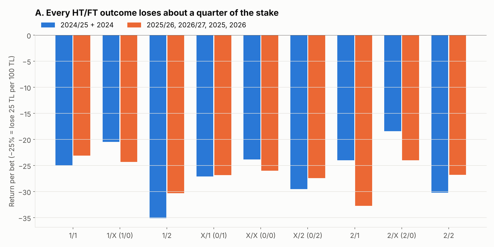
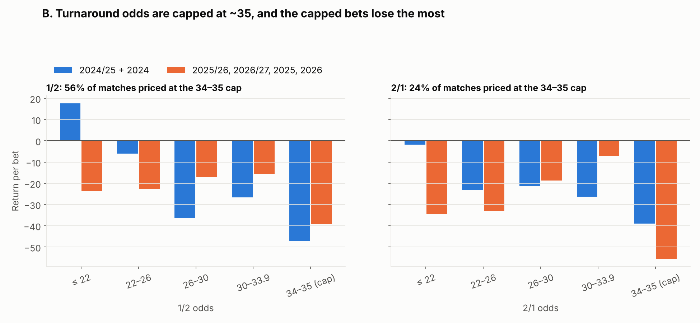
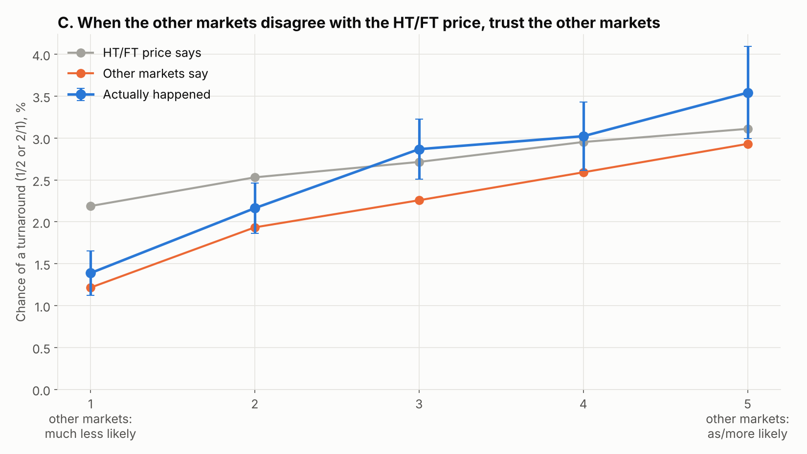
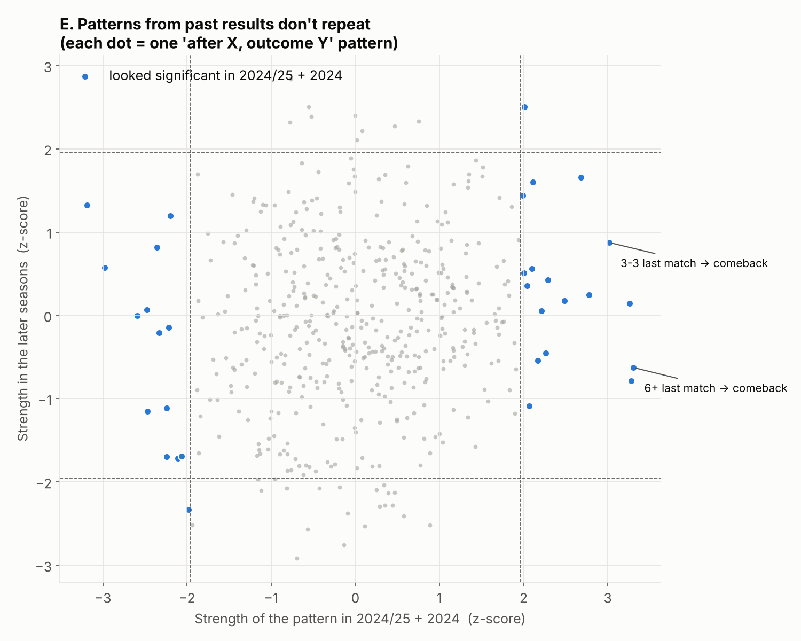
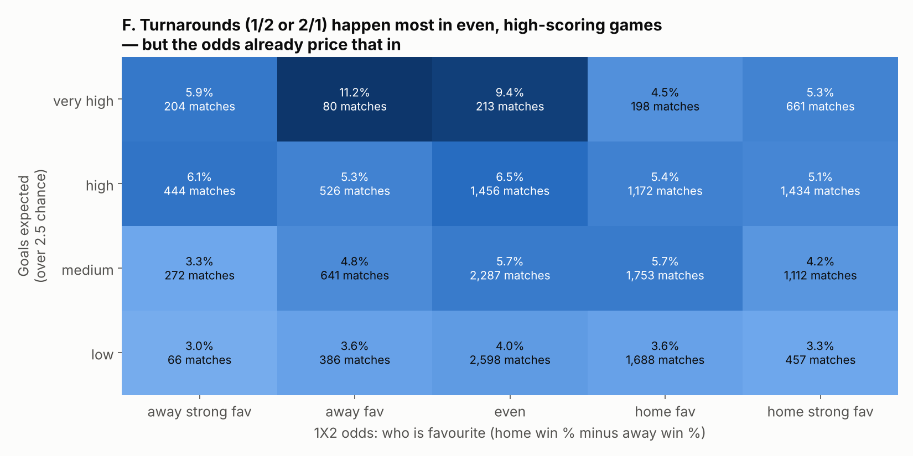

# HT/FT (İY/MS) deep dive

**Data**
- **17,914 matches** where Nesine priced all 9 HT/FT outcomes:
  - 2024/25, 2025/26, 2026/27 so far
  - 2024, 2025, 2026 so far
- Only data collected by this project, using Nesine's closing odds.

**Rebuild:** `python analysis/htft_study.py`. The first run builds `analysis/cache/` in about 3 minutes.

**Files**
- every table: [`output/htft_study.xlsx`](output/htft_study.xlsx), sheets A–H, one per section below
- the code: `htft_data.py` (one row per match), `htft_poisson.py` (cross-market model), `htft_study.py` (analysis)

**How to read it**
- **HT/FT outcome:** the half-time result / the full-time result. For example, **2/1** = the away team leads at half-time and the home team wins. In Turkish notation X is 0, so X/1 = 0/1.
- **Turnaround:** 1/2 or 2/1, where the team leading at half-time loses.
- **Expected:** the chance the HT/FT odds give an outcome after removing Nesine's cut.
- **Return:** what happens if you stake 100 TL on every bet. −25% means you lose 25 TL per 100 TL.
- **Two periods.** Every pattern is first found in **2024/25 + 2024** (discovery) and must then **hold again in the later seasons** (check). Anything that only shows up once is treated as luck.

---

## Short answer

1. **Nesine keeps about 25% on HT/FT.** That is much more than the 16% on 1X2. All 9 outcomes lose 22–32% per bet, in every period.
2. **The odds for 1/2 and 2/1 are capped at about 35.** More than half of all 1/2 prices sit at 34–35. At the cap the turnaround happens only about 1.5% of the time, while the price implies about 2.2%. These are **the worst bets in the market: −39% to −55%**, every period.
3. **Nesine's other markets know better than its HT/FT prices.** When the other odds (team goals per half, 1st-half result, 2nd-half result, …) say a turnaround is unlikely, it really is.
4. **Patterns from past results do not repeat.** That includes your example: "3-2 last week → 2/1 this week". I tested 504 such patterns. The number that held up in later seasons was what pure luck produces.
5. **No model beat the HT/FT prices** on seasons it hadn't seen. That includes a machine-learning model fed about 100 other-market odds plus team history.
6. **One lead is worth tracking:** **1/2 when the away team is favourite or the match is even, and many goals are expected.** It made money in both periods, but on too few bets to trust. See section H.

---

## A. How each outcome pays

| Outcome | Happens | Typical odds | Return |
|---|---|---|---|
| 1/1 | 26.4% | 3.1 | −24% |
| 2/2 | 16.6% | 5.0 | −28% |
| X/X | 15.7% | 4.9 | −25% |
| X/1 | 14.6% | 5.0 | −27% |
| X/2 | 10.9% | 6.8 | −28% |
| 1/X | 5.4% | 13.8 | −23% |
| 2/X | 5.3% | 14.2 | −22% |
| 2/1 | 2.7% | 27.5 | −29% |
| 1/2 | 2.3% | 34.0 | −32% |

- The odds predict how often each outcome happens almost exactly. No outcome happens more often than its price says.
- The turnarounds (1/2, 2/1) are the most expensive to bet.
- **Least bad:** 1/X and 2/X, the "leader gets pegged back to a draw" outcomes, at −22%.

## B. The 35 cap on turnarounds

**What the cap is:** Nesine almost never offers more than **35** for 1/2 or 2/1. Even in a mismatch, where a turnaround is very unlikely, the price stays at 34–35.

**What happens at the cap:** the other markets say the true chance is about **1.3–1.5%**. The cap price implies about 2.2%. In practice:

| Bet at the cap | Happened | Return |
|---|---|---|
| 1/2 at 34–35 | 1.5% / 1.8% | **−47% / −39%** |
| 2/1 at 34–35 | 1.8% / 1.3% | **−39% / −55%** |

The two figures are discovery period / check period.

**What it means:** a turnaround priced at 34–35 is not a "big price". It is a capped price for something that almost never happens. Turnarounds priced lower, at 22–33, lose less (−7% to −37%) but still lose.

## C. Hints in the other odds

**How I built a second price for each HT/FT outcome without using the HT/FT market:**
1. From Nesine's other odds I worked out how many goals each team is expected to score **in each half**. The inputs were team goals over/under, 1st-half goals, 1st-half and 2nd-half results, 1X2 and total goals. The fit matches those markets to within about 1 percentage point.
2. From those four expected-goal numbers I calculated the chance of each HT/FT outcome.
3. I compared that second price with the HT/FT price.

**What the comparison shows (chart C):**
- When the other markets say a turnaround is **much less likely** than the HT/FT price does (group 1), the other markets are right. It happens 1.4% of the time against the 2.2% the HT/FT price implies.
- When the two agree, or the other markets say *more* likely (groups 3–5), turnarounds happen about as often as the HT/FT price says, or slightly more.

**Same story for other outcomes:** the "other markets say less likely" group is the worst bet for every outcome (sheet *C*), in both periods.

**What it means:** the hints in the other odds are real, but they mainly tell you **what not to bet**. They tell you nothing about the result that the odds haven't already priced in.

## D. Can a model beat the HT/FT price?

I trained models on 2024/25 + 2024 and tested them on the later seasons. Inputs were up to **95 other-market odds plus each team's recent history**.

| Model | Better than the HT/FT price alone? |
|---|---|
| Other markets alone | No (very slightly worse) |
| HT/FT price + other markets | +0.04%, practically nothing |
| Machine learning (price + 95 hints + team history) | **Worse** (−1.3%): it learned noise |

- **Betting test:** betting only where a model saw an "edge" lost money at almost every threshold.
- **The one positive row** (+22% on 165 bets) turns into −50% at a stricter threshold. That is noise, not an edge.

**What it means:** the HT/FT price already contains everything the other odds and recent results can tell us.

## E. "Teams that played 3-2 last week…": past-result patterns

**What I tested:** 504 patterns of the form "after X, outcome Y", where X was one of:
- last score (3-2, 2-3, 3-3, 4-1, …)
- last HT/FT (came back, blew a lead, …)
- goals in the last match
- 2nd-half goals
- comebacks or blown leads in the last 10 matches
- days of rest, and rest compared with the opponent

Each pattern was checked against what the odds expected.

| Step | Count |
|---|---|
| Patterns tested | 504 |
| Looked significant in 2024/25 + 2024 | 32 |
| …expected by pure luck | ~25 |
| Significant again in the later seasons | **2** |
| …expected by pure luck | ~1 |

**Your examples** (sheet *E Your examples*). "Comes back" = losing at half-time, winning at full-time.

| After… | Team comes back to win: discovery | Later seasons |
|---|---|---|
| 3-2 win last match | 15 vs 9.5 expected (+9%) | 15 vs 14.1 (**−16%**) |
| 2-3 loss last match | 8 vs 9.3 (−34%) | 20 vs 13.7 (+8%) |
| 3-3 last match | **10 vs 4.0 (+62%)** | 10 vs 7.6 (**−9%**) |
| 6+ goals last match | **41 vs 24.8 (+17%)** | 33 vs 36.7 (**−36%**) |
| Came back last match | 16 vs 10.6 (+7%) | 14 vs 14.2 (**−30%**) |

- **The 3-3 and 6+ goals patterns** looked like gold in the first period and lost money afterwards. That is the classic sign of luck.
- **Teams and leagues:** a team's "comeback tendency" in one period has **no** link to the next (correlation about 0.0 for every outcome). Leagues are no different.
- **Stage of the season:** turnarounds happen less often in the first 15% of the season, and 1/1 slightly more often in the last 15%. Both are small, and the bets still lose (sheet *G*).

**What it means:** last week's score is already in this week's odds. Patterns found by looking back mostly disappear when you look forward.

## F. What turnaround matches look like

- **Where they happen:** turnarounds happen most in **evenly matched, high-scoring** games (6–9%), and least in low-scoring games (3–4%).
- **What the 1X2 odds show:** when 1/2 hit, the away team's average win chance was 35% (all matches: 31%). When 2/1 hit, the home team's was 46% (all matches: 43%). So the team that comes back is usually the slightly stronger one.
- **The catch:** the odds already know all this. The cut-adjusted price follows the same map, and most of the bright cells disappear once you compare them with the price (sheet *F Where turnarounds*).

## H. Watch list (leads, not proven)

| Lead | 2024/25 + 2024 | Later seasons |
|---|---|---|
| 1/2 when away is favourite or match is even, over 2.5 chance > 65% | 12 hits vs 5.8 exp., **+51%** | 17 vs 12.7, **+2%** |
| 1/2 priced ≤ 20 | 9 vs 4.1, **+65%** | 17 vs 11.7, **+11%** |
| 1/2 priced ≤ 26 | 60 vs 44, +1% | 71 vs 70, −23% (faded) |
| 1/2 or 2/1 at the 34–35 cap | −47% / −39% | −39% / −55% (**avoid**) |

**Why the first lead is plausible:**
- A stronger away team in an open, high-scoring game often concedes first and then comes back.
- These 1/2 prices are well below the cap, so the cut on them is smaller.

**Why it is not proven:**
- It is only about 500 bets with 29 hits.
- I found it by looking at the data, so the later seasons are not a clean test.
- The mirror case (2/1 with a home favourite) does **not** work.

**Suggestion:** record these bets on new matches from now on, without betting, and check again in a few months.

---

## Ideas for the next round

- **Line movement.** Opening vs closing odds is only available for matches collected since 6 Oct 2026. A big drop in the 2/1 price before kickoff could be a genuine signal. This needs a few months of data.
- **Older seasons.** When the backfill finishes 2019–2023, the watch-list leads can be tested on about 40,000 more matches the analysis has never seen. That is the honest test.
- **Live/in-play:** not collected, so not possible.
