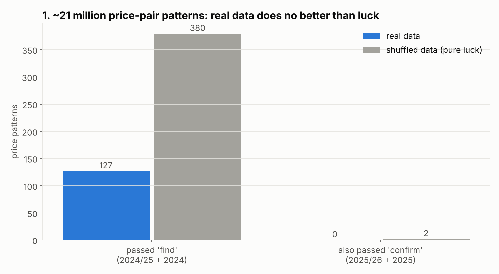
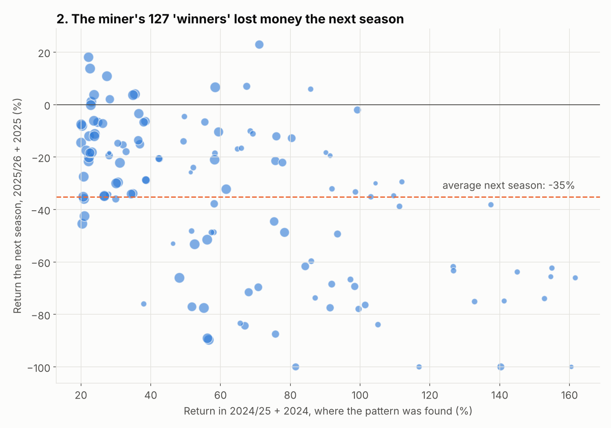
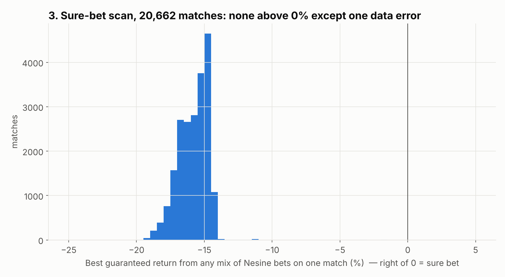

# Signal hunt, rounds 2–3: brute force, new models, sure bets

**Data:** 20,662 matches with Nesine closing odds, from this project's data only.

**Every table:** [`output/miner_study.xlsx`](output/miner_study.xlsx).

**The three gates.** Every idea had to pass these, fixed *before* running anything:

| Gate | Period | Rule |
|---|---|---|
| 1. Find | 2024/25 + 2024 | Makes money, with a clear signal |
| 2. Confirm | 2025/26 + 2025 | Makes money again |
| 3. Final exam | 2026/27 + 2026 | Looked at only for ideas that passed gates 1 and 2 |

**Why the gates are needed.** With millions of tries, thousands of patterns look great by pure luck. A "luck control" run, the same search on shuffled data, shows how many to expect from chance alone.

## Result: nothing passed

| Idea | Tested | Passed find | Passed confirm |
|---|---|---|---|
| **Price-pair miner**: every pair of 162 prices (ratio in 10 bands, or "equal within 0.10" like your over 4.5 / both-halves example) × every one of 162 bets | ~21 million | 127 | **0** (luck control: 380 / 2) |
| **Whole-price-list models**: logistic regression, gradient boosting and "similar matches", each seeing all ~160 prices of the match, for every bet type | 468 models | — | **0** |
| **Learned goal model**: boosting predicts each team's goals per half from the full price list, then prices every goal bet | 156 bet types | — | **0** |
| **Internal sure bets**: best possible mix of all goal bets on a match | 20,662 matches | — | **0** real ones |
| Your example: over 4.5 ≈ both halves over 1.5 → 6+ goals | 1 rule | — | 6+ does land more often (11–12% vs 6–7%), but Nesine already prices it at 13–14%: **−30% to −39%** |
| Stale exotic prices, unusually low cuts, kick-off time/weekday, team habits, messy price lists, end-of-season motivation, promoted teams | ~200 groups | — | **0** |

The real data produced **fewer** "winners" than the shuffled data. There is no hidden layer of price patterns.

The miner's best finds made +20% to +160% in the period where they were found. The next season they lost **35% on average**, which is exactly what ordinary long-shot bets lose.

**Sure-bet scan.** Mixing every available goal bet on a match (1X2, over/under, both score, halves, combos, correct score, HT/FT, …), the best *guaranteed* result is **−11% to −20%** for every normal match. Nesine's prices are consistent across its own markets.

## Two data problems found (for the collection session)

1. **Wrong market under the "both teams score in 1st half / 2nd half" ID** (`HT_2H_BTTS`, id 801).
   - **Affected:** at least 211 matches in Oct–Nov 2025 (and one ARG-1 match on 31 Oct 2025 with a missing price).
   - **What happened:** the stored prices are really those of **"goal in the 1st half / goal in the 2nd half"**. For example, "Yes/Yes" at 1.33 is priced at 58.4% and happened 58.8% of the time, whereas both-teams-score-in-each-half happened only 5.7%. These prices were settled against the wrong market.
   - **Effect:** this error created fake "+138%" model results and a fake "+228% sure bet". It is now excluded in `miner_data.py` and `arb_scan.py`.
2. **Odd prices from the secondary `new` source.**
   - 4 France 1 / Germany 2 matches in September 2026 have markets with an ~8–9% cut, against Nesine's usual ≥15%.
   - A few other `new`-source records have incomplete markets.
   - Worth checking whether these are really Nesine prices.

## What is left

- **Price movement (opening → closing).** Collected only since 6 Oct 2026; so far just 11 settled matches. This is the most promising untested idea, and it needs a few months of data.
- **Older seasons.** When the backfill finishes 2019–2023 (~40,000 matches), every idea above can be re-run on data it has never seen.
- **Unusual-cut alert.** The only truly "good" prices in the whole dataset were the rare low-cut markets. A daily check of upcoming matches for markets whose cut is far below Nesine's normal ~15% would catch any promotions or mistakes as they happen.
