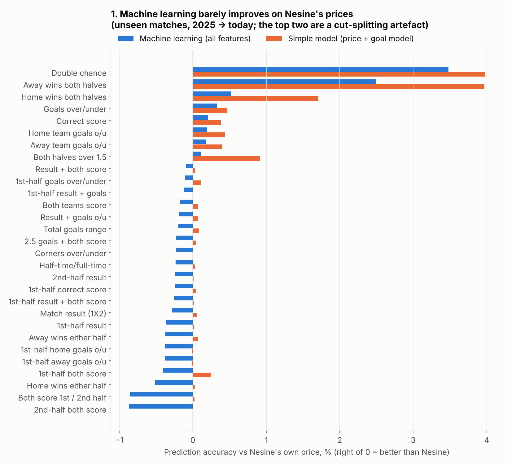
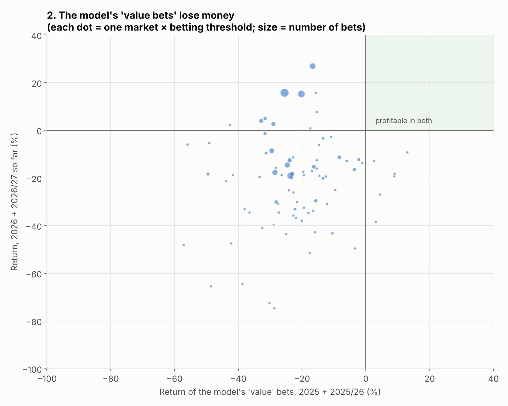
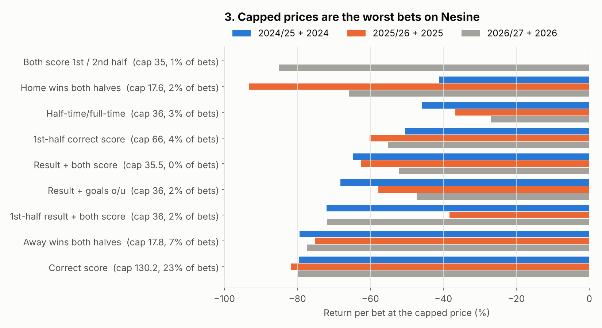
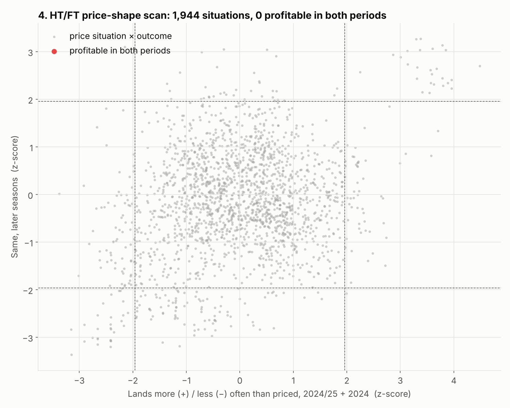
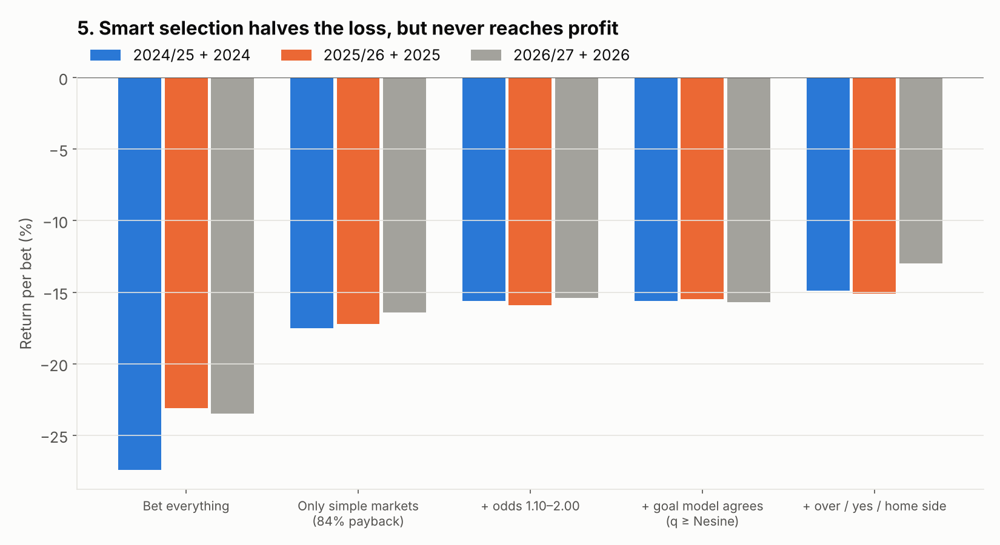

# Signal hunt across all markets (machine learning + targeted tests)

**What was tested:** every market Nesine prices that this project collects, 29 markets in total.
- **Matches:** 20,662, from 2024/25, 2025/26 and 2026/27 so far, plus 2024, 2025 and 2026 so far
- **Bets:** 2.73 million settled selections
- **Data:** only data collected by this project, using Nesine's closing odds

**Rebuild:** run these four steps in order:
1. `python analysis/ml_data.py` (~3 min)
2. `python analysis/ml_walkforward.py` (~40 min)
3. `python analysis/ml_evaluate.py`
4. `python analysis/ml_study.py`

**Every table:** [`output/ml_study.xlsx`](output/ml_study.xlsx).

**How to read it**
- **Return:** what happens if you stake 100 TL on each bet. −15% means you lose 15 TL per 100 TL.
- **Three periods:**

  | Period | Seasons |
  |---|---|
  | A | 2024/25 + 2024 |
  | B | 2025/26 + 2025 |
  | C | 2026/27 + 2026 so far |

- **The test:** a pattern counts only if it shows up again in the periods that came *after* it was found. Machine-learning models are tested **walk-forward**: they are retrained every 3 months on earlier matches only, and judged only on matches they have never seen.

---

## Short answer

I searched hard. The tests included:
- machine learning on all 29 markets
- over 2,000 price situations, including your "1/0 = 2/0" idea and every other pair of HT/FT prices
- form, shots, corners, rest, popular clubs, price limits and stage of season

**Nothing makes money in a way that repeats.** The reason is clear and the same everywhere:

- **Nesine's prices are very accurate.** Once its cut is removed, almost everything happens as often as the odds say.
- **The cut is large:**

  | Market type | Cut |
  |---|---|
  | Simple markets | 16% |
  | HT/FT and combinations | 21–25% |
  | Correct score | 37% |

  For a bet to make money, the prices would have to be wrong by more than that. In our data they never are, consistently.

What the data *does* show reliably is **where you lose the most and where you lose the least**. That is the useful result, and it repeats in every period.

---

## 1. Machine learning on every market

**What the models saw for each market:**
- Nesine's own price and cut
- a **goal model price**. From Nesine's main odds I worked out each team's expected goals per half. That gives a second price for every bet: combos, correct scores, HT/FT and so on.
- **team form from before kickoff:** goals, shots, shots on target, corners, possession, and results compared with what the market expected
- league, rest days, stage of season, kick-off time and weekday

**Results**
- **Most markets:** the machine-learning model did *worse* than Nesine's price on unseen matches. It learned noise.
- **The simple model** (price + goal model) improves on Nesine by only 0.0–0.5% on most markets.
- **The two "winners" at the top** (double chance, "wins both halves") are not real value. They only correct how I split Nesine's cut on those odd markets, and their bets still lose.

**The betting test:** bet whenever the model thinks a bet is worth more than its price.
- **Across all markets:** the bets lost **22–26% in period B and 14–20% in period C**.
- **Per market:** no market × threshold combination was profitable in both B and C.

## 2. Price limits: the most reliable finding

**Caps.** Nesine caps long prices:

| Market | Cap | Share of bets at the cap |
|---|---|---|
| Correct score | 130 | 23% |
| HT/FT and result combinations | ~35–36 | — |
| 1st-half correct score | 66 | — |
| "Wins both halves" | ~17.6 | — |

At the cap the outcome is far less likely than the price suggests. **Capped bets lose 40–95% in every period.**

**Floors.** Nesine also has floors on short prices, such as over 1.5 at 1.13, under 3.5 at 1.13 and 1st-half over 0.5 at 1.21.

**The exact-price scan:** I checked 201 cases of "this exact price on this selection".
- Their over- or under-performance repeats well between periods (correlation 0.55).
- They are all the same cap/floor effect.
- **None made money in both periods.**

## 3. Your HT/FT ideas

- **"1/0 and 2/0 priced the same"** (3,900 matches). Every outcome lands about as often as priced, and all lose. No outcome stands out in both periods.
- **Every pair of HT/FT prices** (36 pairs × 6 bands × 9 outcomes = 1,944 situations).
  - Some patterns do repeat: the top-right and bottom-left dots in the chart. They are all one thing: in big mismatches, 1/1 lands slightly more often than priced and 1/2 / 2/1 much less (the cap again).
  - **0 of 1,944 were profitable in both periods.** Even the best 1/1 situations lose 14–18%.
- **X/1, X/X and X/2 vs the 1st-half and 2nd-half result markets.** Nesine builds these HT/FT prices directly from its two half markets (correlation 0.997). No gap is left to exploit.

## 4. Form, stats and other ideas (sheet *3*)

| Idea | Finding |
|---|---|
| Shots-on-target form vs goal markets | Nothing consistent. Already in the odds. |
| "Lucky" teams who scored more than expected | No regression to exploit. |
| Corner form vs the corner line | Mixed across periods. Corner bets lose 15–30%. |
| Rest days, points form | Nothing. |
| Popular clubs (Turkish big 4, big European clubs) | They win slightly *more* often than priced. Backing their opponents loses **31–51%** in every period. Backing them still loses 6–16%. |
| Big single-bet matches (MBS 1) | "Both teams score: yes" lands 2–3.5 points more often than priced in all three periods. Still loses 9–12%. |
| Start of season, kick-off time | Nothing consistent. |

## 5. The useful result: how to lose the least

Rules fixed on period A and tested on B and C:

| Rule | A | B | C |
|---|---|---|---|
| Bet everything | −27% | −23% | −24% |
| Only simple markets (1X2, over/under, both teams score, half markets, team goals) | −17% | −17% | −16% |
| + odds 1.10–2.00 | −16% | −16% | −15% |
| + over / yes / home side, goal model agrees | **−15%** | **−15%** | **−13%** |

**Avoid:**
- capped prices: correct score at 130, any HT/FT or combo at 34–36
- correct score in general
- turnarounds (1/2, 2/1)
- long shots over 10
- betting against popular clubs

Good selection **halves the loss**, but the floor is the cut itself, about 13–16%.

---

## Where a real edge could still come from

| Source | Status |
|---|---|
| **Price movement** (opening vs closing) | Collected only since 6 Oct 2026. In a few months we can test whether early prices that later drop are "beatable". This is the most promising remaining idea. |
| **Older seasons (2019–2023)** | Once the backfill finishes, any lead can be tested on about 40,000 more unseen matches. |
| **Other bookmakers' prices** | Would be the classic way to find value, but the rule is Nesine/Mackolik data only, so not used. |
