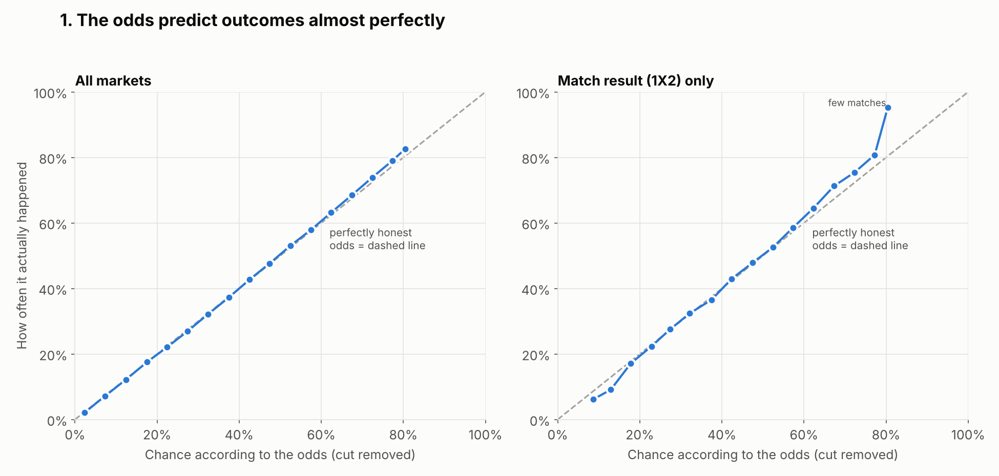
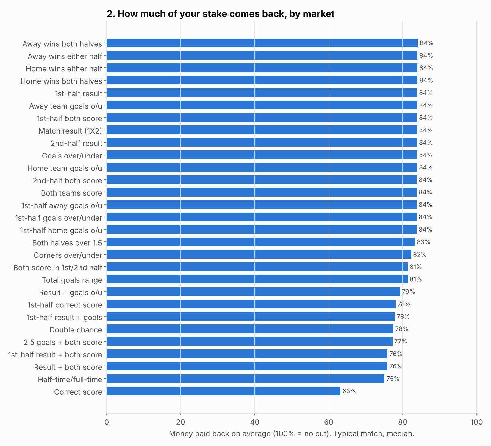
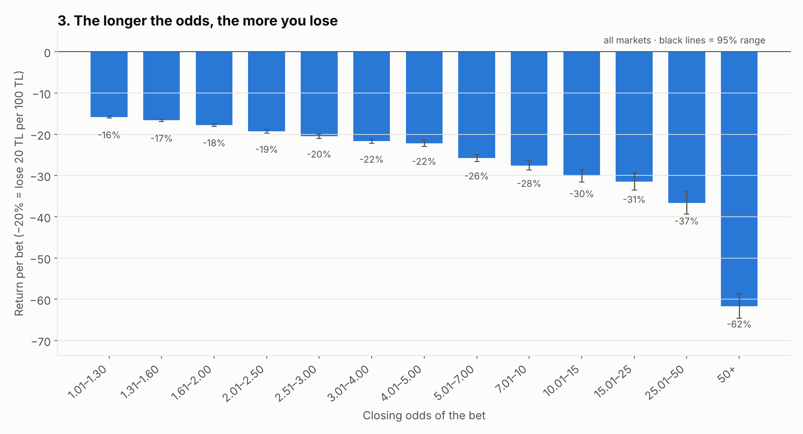
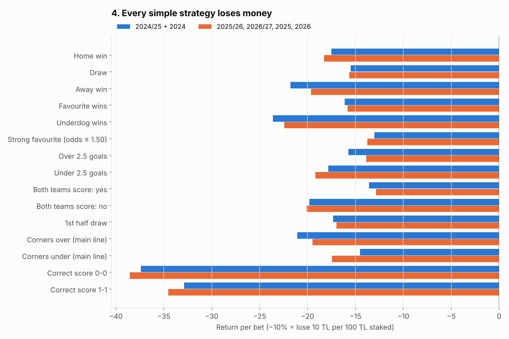
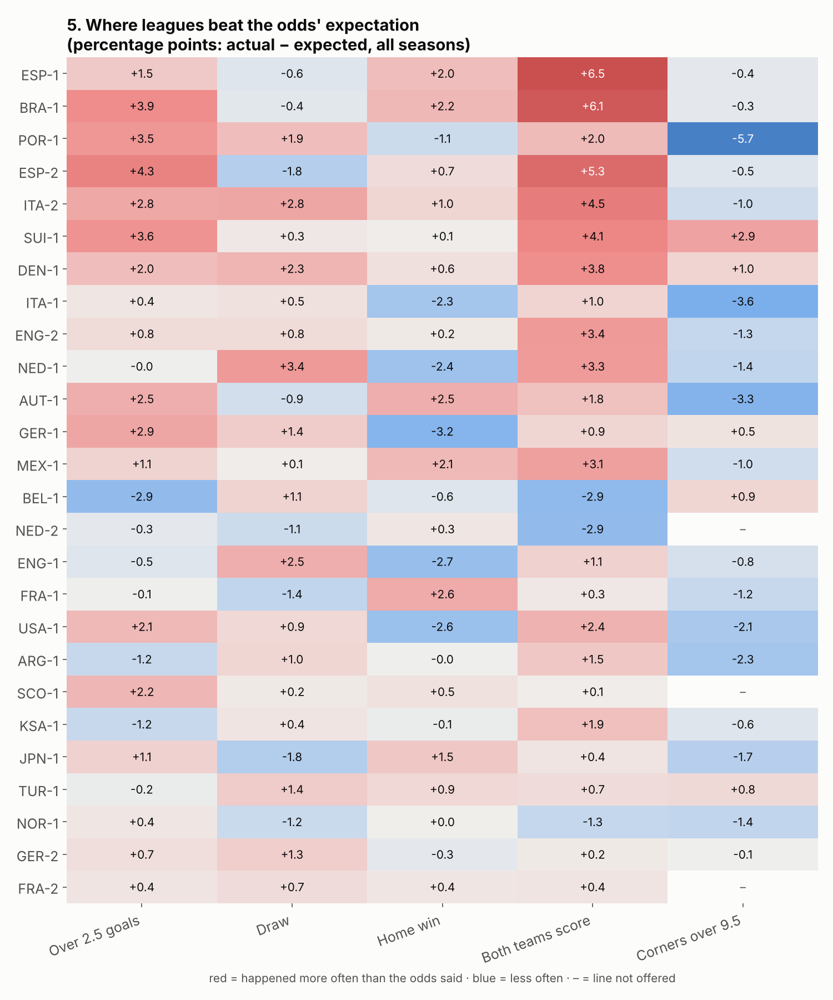

# First look at the odds (2024/25 – 2026/27)

**Data:** Nesine closing odds collected by this project only.

| Group | Seasons |
|---|---|
| 21 split-season leagues | 2024/25, 2025/26, 2026/27 (matches played so far) |
| 5 calendar-year leagues (ARG, BRA, JPN, NOR, USA) | 2024, 2025, 2026 (matches played so far) |
| Japan | also 2026/27, after its switch to an autumn–spring calendar |

That comes to **20,700 matches and 2.73 million priced, settled bets**.

**Left out:**
- the TUR-1 placeholder entries
- Japan's special 2026 tournament
- anything not settled

**Rebuild:** `python analysis/first_look.py`

**Files:**
- every table is in [`output/first_look.xlsx`](output/first_look.xlsx), one sheet per table
- the charts are in [`output/`](output/)

**How to read the numbers**
- **Return per bet** is what happens if you stake 100 TL on each bet. −15% means you lose 15 TL for every 100 TL staked.
- **95% range** is the band the true value very probably falls in. If the whole range is below zero, the loss is real and not bad luck.
- **Two periods.** To avoid fooling ourselves, the data is split in two:
  - the *discovery* period: 2024/25 and 2024
  - the *check* period: everything later

  A pattern only counts if it shows up in both.

---

## 1. Are the odds honest? Yes, very.

**How the check works**
- First, Nesine's cut is removed from the odds.
- What's left is the chance the odds give each outcome. For example, odds of 1.95 mean about 43%.
- Then that is compared with how often the outcome really happened.

**Results**
- Across all markets the dots sit on the dashed "perfect" line. Most groups are within half a percentage point.
- Every market is accurate to within 2 points on average (sheet *1 By market*).
- There is one small, steady pattern: **favourites happen slightly more often than the odds say**.
  - Outcomes priced at 65–85% happen 1–2 points more often.
  - Long shots happen slightly less often.

**What it means:** the odds already contain almost all the information. To beat them you would need to know something they don't.

## 2. How much does Nesine keep? About 16% on simple bets, much more on combinations.

**Payback** is the share of all money staked that comes back to bettors on average.

| Bet type | Payback | Nesine keeps |
|---|---|---|
| 1X2, over/under, both-teams-score, half markets | **84%** | 16% |
| Corners | 82% | 18% |
| Goal range | 81% | 19% |
| Result + goals, double chance, HT/FT | 75–79% | 21–25% |
| **Correct score** | **63%** | **37%** |

- **The cut is a fixed rule, not a judgement call:** almost every league gets exactly 84.0% (sheet *2 Payback by league*).
- **Exception:** **MEX-1, NED-2, KSA-1, ARG-1, USA-1 (~82%)** and BRA-1 (83%) pay back a little less.
- **Over time:** the cut has not changed between seasons.

**What it means:** before anything else, every bet starts about 16% behind. Combination and score bets start 20–37% behind.

## 3. Favourites vs long shots: the longer the odds, the bigger the loss.

| Odds | Average loss per bet |
|---|---|
| Up to 1.30 | 16% |
| 2.0–2.5 | 19% |
| 5–7 | 26% |
| 10–15 | 30% |
| Over 50 | 62% |

This holds in every market family and is very certain: the 95% ranges are tiny. Part of it is that long-odds bets sit in high-cut markets such as correct score. But even within plain 1X2, odds over 5 lose 30–60% (sheet *3 Return by odds - 1X2*).

**What it means:** if you bet at all, short odds lose the least. Long shots are where the money disappears.

## 4. Simple strategies: all lose, roughly by the size of the cut.

**Strategies tested:** 15 simple ones, such as "always back the home team", "always over 2.5" and "always under on corners".

**Results**
- **All 15** lose money in **every one of the 6 seasons** (sheet *4 By season*).
- **The least bad:**

  | Strategy | Return |
  |---|---|
  | Both teams to score: yes | −13% |
  | Strong favourites (odds ≤ 1.50) | −13% |
  | Over 2.5 goals | −15% |
  | Draw | −16% |

- **The worst:**

  | Strategy | Return |
  |---|---|
  | Correct score 0-0 | −38% |
  | Correct score 1-1 | −34% |
  | Underdog | −23% |

- **"Yes / over" is slightly better than "no / under", every season.** BTTS "yes" lands 54.6% of the time against 52.6% expected. Over 2.5 lands 52.6% against 51.5%. That shaves a few points off the loss, but nowhere near enough to make money.

**League by league:** I took every strategy × league combination (390 in total) and checked which made a profit in the discovery period. Only **3** did, and all at under +1%. In the check period those same 3 lost **22%** together (sheet *4 Winners later*). That is exactly what luck looks like.

**What it means:** at these odds, simple rules don't make money, and "it worked last season in league X" is not evidence.

## 5. League personalities: real for "both teams score", noise for most others.

Each cell shows how much more (red) or less (blue) often something happened than the odds expected, over all seasons. Some leagues stand out:

| Leagues | What stood out |
|---|---|
| ESP-1 +6.5, BRA-1 +6.1, ESP-2 +5.3, ITA-2 +4.5 | Both teams scored more often than expected |
| POR-1 −5.7 | Fewer corners than the 9.5 line suggested |

**Did it repeat?** I compared each league's surprise in the discovery period with the check period (sheet *5 Did it repeat*):

| Measure | Repeats? |
|---|---|
| Both teams score | **Somewhat** (correlation 0.37; same direction in 62% of leagues) |
| Over 2.5, draws, home wins, corners | **No** (correlation about 0 or negative; same direction about half the time, like a coin flip) |

**What it means:** only "both teams score" looks like a lasting league trait, and it overlaps with the general "yes is slightly underpriced" effect from section 4. The rest of the colours in the chart are mostly luck.

---

## Bottom line

1. Nesine's closing odds are very accurate. Their cut is about 16% on simple markets and much higher on combinations and scores.
2. No simple strategy, overall or per league, made money over these 2½ seasons. Patterns that looked profitable in one season did not survive the next.
3. The only steady leans are small: slightly underpriced favourites and "yes/over" bets, most of all BTTS-yes in Spain and Brazil. They reduce the loss; they don't make money.

**Next steps:**
- **Check BTTS-yes and Over 2.5 in those leagues** in more detail, with more seasons once the backfill finishes.
- **Look at odds movement** (opening vs closing). This is only possible for matches collected since 6 October 2026, so it needs a few more weeks of data.

## Data issues found (collection code not touched)

- **One-sided markets get a 100% fair chance.** When only one selection of a market has a price, `analysis_flat` treats the market as complete. It sets `fair_prob = 1.0` and a negative `market_margin`.
  - Affected: mostly *Home/Away wins both halves*, *Both halves over 1.5* and *either half* (~16,000 matches), where only "Yes" is stored.
  - In this analysis these one-sided markets are left out of the fair-chance and cut checks. They still count as bets.
- **Missing half-time scores.** About 150 matches, mostly in the 2026 calendar season, have no half-time score. Their "1st-half away goals" bets are unsettleable.
- **One unsettled HT/FT market.** BRA-1 match `1raek4m4p4rskbybs88jpsmj8` (2026-10-07) has its HT/FT market with no settlement status.
