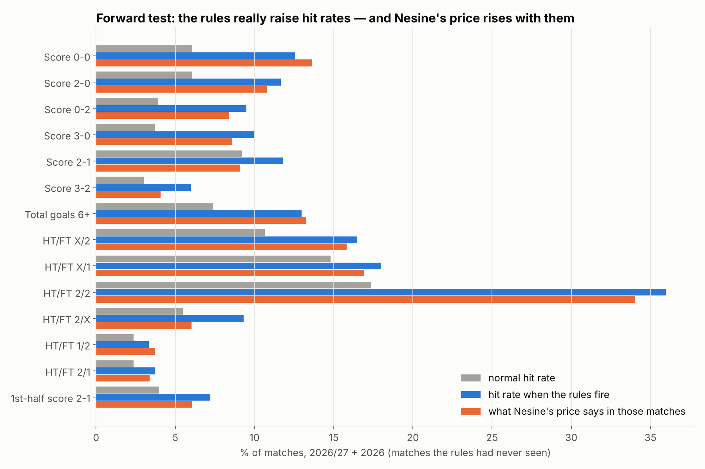

# Rule book: when do outcomes land more often than usual?

**What this is:** price rules in the style of "when over 4.5 and both-halves-over-1.5 odds are about the same, 6+ goals is more likely". Each rule makes a bet hit clearly more often than usual. These rules are about **hit rates**, not profit.

**Data:** Nesine closing odds collected by this project, 20,662 matches.

**Rebuild:**
1. `python analysis/rule_miner.py` (finds the rules, ~10 s)
2. `python analysis/rules_study.py` (writes the rule book)

**The rule book:** [`output/rules_book.xlsx`](output/rules_book.xlsx). It has filter arrows on every sheet.

## How the rules were found

**Condition types** (all from a match's closing odds; 6,611 conditions in total):

| Type | Example |
|---|---|
| Two odds equal | "Away win ≈ home scores 0 in the 1st half (within 0.10)" |
| One odds unusually cheaper than another | "1st-half home & over 1.5 cheaper than 1st-half draw" |
| An odds below a level | "Under 0.5 goals odds ≤ 5.67" |

**What each condition was tested against:** every bet in a **different market** from the condition, so there are no obvious "home odds low → home wins" rules.

**What a rule had to do to be kept:**
- In **each** of the three periods (2024/25 + 2024, 2025/26 + 2025, 2026/27 + 2026 so far), hit clearly more often than normal, at least ×1.25, with strong statistical evidence.
- Have at least 500 matches in total.

**Result:** 60,910 rules held up. Many are variations of the same idea, so the rule book shows the best of each kind.

## Examples

| When … | Bet | Hit rate per period | Normally |
|---|---|---|---|
| 1st-half home & over 1.5 cheaper than 1st-half draw | Home scores 2+ | 83% / 78% / 81% | 44% |
| 1st-half home cheaper than home under 2.5 | Home win | 80% / 82% / 74% | 43% |
| Total goals 6+ cheaper than draw | Over 2.5 | 74% / 75% / 76% | 53% |
| Both halves over 1.5 cheaper than 1st-half draw | Total goals 6+ | 18% / 18% / 22% | 6% |
| Away win ≈ home scores 0 in 1st half (within 0.10) | Away wins both halves | 25% / 22% / 26% | 7% |
| Draw cheaper than over 2.5 | Total goals 0–1 | 46% / 45% / 46% | 24% |
| Away win & both score cheaper than 2nd-half draw | HT/FT 1/2 | 5.1% / 5.6% / 5.1% | 2.3% |
| Away & under 3.5 cheaper than away over 1.5 | Score 0-0 | 15% / 14% / 15% | 7% |

## What the rules can and cannot do

- **They really work as predictions.** Every rule held in three separate periods.
- **Nesine's own price for the bet already knows it.** In the matches where a rule is met, the price gives almost the same chance; see the "Nesine's price says %" column.
- **They don't make money.** Flat betting on them still loses (see "Return per 100 TL"). Only 1 of the 60,910 rules was profitable in all three periods, which is what luck alone would produce.
- **Use them to read a match quickly**, for example "this price list points to an away win in both halves", not as a betting edge.

---

## Part 2: HT/FT, both teams score, and both teams score in both halves

**Rebuild:**
1. `python analysis/rules_targets.py` (~1 min)
2. `python -c "import sys; sys.path.insert(0,'analysis'); import rules_targets as r; r.study()"`

**The file:** [`output/rules_htft_btts.xlsx`](output/rules_htft_btts.xlsx), one sheet per bet, with rules in English and Turkish (*Kural*).

**The bets** are worked out from the scores, so all three periods count:
- the 9 HT/FT outcomes
- both teams score: yes
- both teams score in **both** halves
- both teams score in the 1st half
- both teams score in the 2nd half

**Rule types:**
- one odds inside a price range ("Toplam Gol Aralığı 2-3 oranı 1.80–1.90")
- **two** price ranges at once (… VE …)
- equal or cheaper pairs

**Rules found** (every one held in all three periods):

| Bet | Normally | Rules | Best rule hits |
|---|---|---|---|
| HT/FT 1/1 | 26.6% | 5,744 | 66.5% |
| HT/FT 2/2 | 16.7% | 4,002 | 50.2% |
| HT/FT X/2 | 10.9% | 2,794 | 21.9% |
| HT/FT X/X | 15.4% | 1,593 | 27.0% |
| HT/FT X/1 | 14.5% | 477 | 23.1% |
| HT/FT 1/2 | 2.3% | 142 | 6.8% |
| HT/FT 2/X | 5.3% | 17 | 11.9% |
| HT/FT 2/1 | 2.7% | 10 (moderate) | 6.0% |
| HT/FT 1/X | 5.4% | 0 | — |
| Both teams score: yes | 55.0% | 501 | 70.3% |
| Both teams score in BOTH halves | 5.8% | 519 | 12.7% |
| Both teams score in 1st half | 20.6% | 563 | 34.3% |
| Both teams score in 2nd half | 27.5% | 134 | 38.5% |

**Your example, Total goals 2-3 at 1.80–2.00 → under 2.5:** under 2.5 is *less* likely, not more.

| Total goals 2-3 odds | Under 2.5 |
|---|---|
| ≤ 1.80 | 52–55% |
| 1.80–1.90 | 46% |
| 1.90–2.00 | 39% |
| 2.00–2.20 | 30% |

The normal rate is 47%. A higher "2-3 goals" price means Nesine expects an unusual number of goals, almost always *more*.

---

## Part 3: deep search, up to THREE conditions, for high-odds bets

**Rebuild:** run these in order:
1. `python analysis/rules_deep.py` (~5 min)
2. `python analysis/rules_forward.py`
3. `python analysis/rules_deep_study.py`

**The file:** [`output/rules_deep.xlsx`](output/rules_deep.xlsx). It has a summary, the forward test, and one sheet per bet with up to 1,500 rules each, in English and Turkish.

**Bets covered:**
- the 9 HT/FT outcomes, plus turnarounds
- 18 full-time scores
- 5 first-half scores
- 6+ goals and 5+ goals
- both teams score in both halves

**How the search worked:**
- **Building blocks:** 3,385 of them: 1,447 price ranges and 1,938 "equal odds" pairs.
- **One- and two-condition rules:** all of them were tested.
- **Three-condition rules:** the best 400 two-condition rules were each extended with every building block.
- **The three gates:**
  1. Rules were found in 24/25 + 2024.
  2. They were confirmed in 25/26 + 2025.
  3. They were checked in 26/27 + 2026.
- **Result:** ~121,000 rules.
- **Luck control:** the same checks were rerun with shuffled results to count how many rules luck alone would pass.

| Rating | Meaning | Bets |
|---|---|---|
| Very reliable | luck explains < 2% of rules | most bets, including all main HT/FT outcomes, most scores, 6+, BTTS both halves |
| Reliable | luck explains 2–10% | HT/FT 2/1, scores 1-2, 0-3, 4-1 |
| Mixed | luck explains 10–50% | HT/FT 2/X, turnaround, scores 1-1, 3-3 |
| Unreliable | most rules could be luck | HT/FT 1/X, score 2-2, 1st-half 1-1 |

**Forward test.** Rules ranked using only 24/25 and 25/26 were applied to 26/27 + 2026 matches they had never seen:

| Bet | Normal hit | Hit when rules fire |
|---|---|---|
| 0-0 | 6% | 12.6% |
| 6+ goals | 7.4% | 13% |
| 3-0 | 3.7% | 10% |
| 0-2 | 3.9% | 9.5% |
| HT/FT 2/2 | 17% | 36% |

- **The rules work.**
- **Nesine's price mostly rises with them**, so flat betting loses. It loses *less* than betting those outcomes blindly; for example, 6+ goals loses 19% instead of 32%.
- **Watch list:** for HT/FT 2/0, scores 2-1, 3-2, 3-0, 0-2 and 1st-half 2-1, the rules hit *more* often than Nesine's price implies in the fresh period. Most still lose a little after the cut (score 3-2 −3%; HT/FT 2/0 +18%), and samples are small (200–500 bets). They need more data before anyone relies on them.
