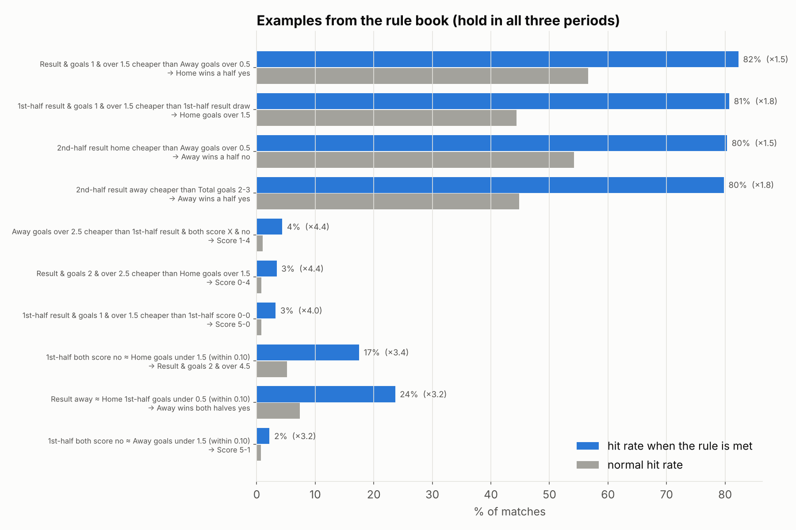

# Rule book: when do outcomes land more often than usual?

**What this is:** price rules in the style of "when over 4.5 and both-halves-over-1.5 odds are about the same, 6+ goals is more likely". Each rule makes a bet hit clearly more often than usual. These rules are about **hit rates**, not profit.

**Data:** Nesine closing odds collected by this project, 20,662 matches.

**Rebuild:**
1. `python analysis/rule_miner.py` (finds the rules, ~10 s)
2. `python analysis/rules_study.py` (writes the rule book)

**The rule book:** [`output/rules_book.xlsx`](output/rules_book.xlsx). It has filter arrows on every sheet.

## How the rules were found

**Condition types** (all from a match's closing odds; 6,611 conditions in total):

| Type | Example |
|---|---|
| Two odds equal | "Away win ≈ home scores 0 in the 1st half (within 0.10)" |
| One odds unusually cheaper than another | "1st-half home & over 1.5 cheaper than 1st-half draw" |
| An odds below a level | "Under 0.5 goals odds ≤ 5.67" |

**What each condition was tested against:** every bet in a **different market** from the condition, so there are no obvious "home odds low → home wins" rules.

**What a rule had to do to be kept:**
- In **each** of the three periods (2024/25 + 2024, 2025/26 + 2025, 2026/27 + 2026 so far), hit clearly more often than normal, at least ×1.25, with strong statistical evidence.
- Have at least 500 matches in total.

**Result:** 60,910 rules held up. Many are variations of the same idea, so the rule book shows the best of each kind.

## Examples

| When … | Bet | Hit rate per period | Normally |
|---|---|---|---|
| 1st-half home & over 1.5 cheaper than 1st-half draw | Home scores 2+ | 83% / 78% / 81% | 44% |
| 1st-half home cheaper than home under 2.5 | Home win | 80% / 82% / 74% | 43% |
| Total goals 6+ cheaper than draw | Over 2.5 | 74% / 75% / 76% | 53% |
| Both halves over 1.5 cheaper than 1st-half draw | Total goals 6+ | 18% / 18% / 22% | 6% |
| Away win ≈ home scores 0 in 1st half (within 0.10) | Away wins both halves | 25% / 22% / 26% | 7% |
| Draw cheaper than over 2.5 | Total goals 0–1 | 46% / 45% / 46% | 24% |
| Away win & both score cheaper than 2nd-half draw | HT/FT 1/2 | 5.1% / 5.6% / 5.1% | 2.3% |
| Away & under 3.5 cheaper than away over 1.5 | Score 0-0 | 15% / 14% / 15% | 7% |

## What the rules can and cannot do

- **They really work as predictions.** Every rule held in three separate periods.
- **Nesine's own price for the bet already knows it.** In the matches where a rule is met, the price gives almost the same chance; see the "Nesine's price says %" column.
- **They don't make money.** Flat betting on them still loses (see "Return per 100 TL"). Only 1 of the 60,910 rules was profitable in all three periods, which is what luck alone would produce.
- **Use them to read a match quickly**, for example "this price list points to an away win in both halves", not as a betting edge.
